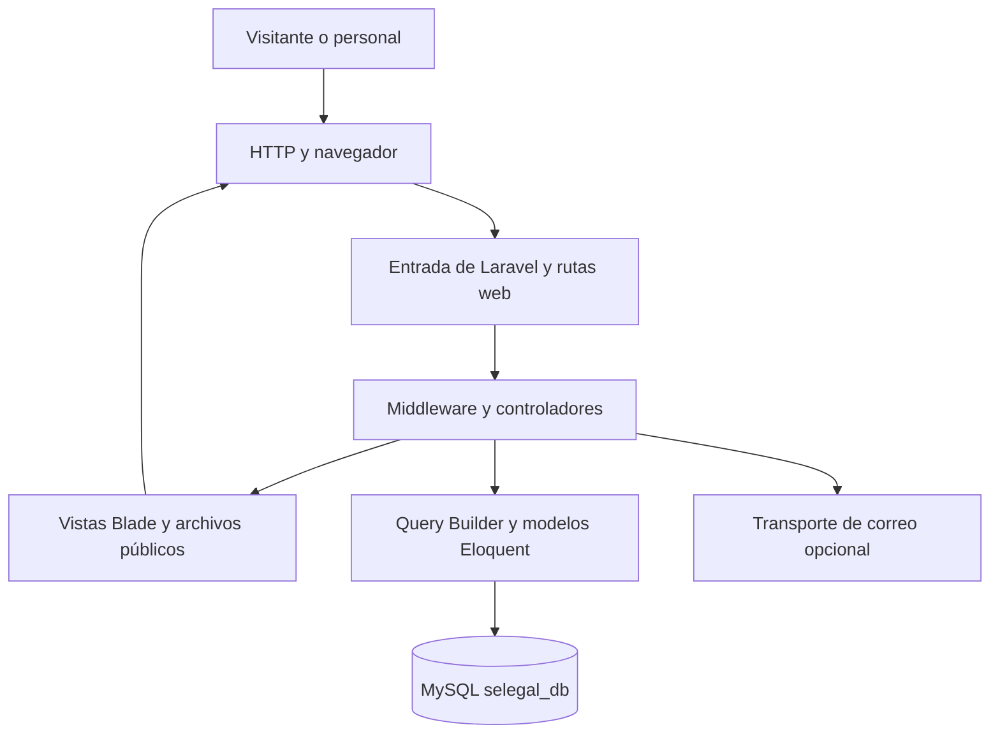
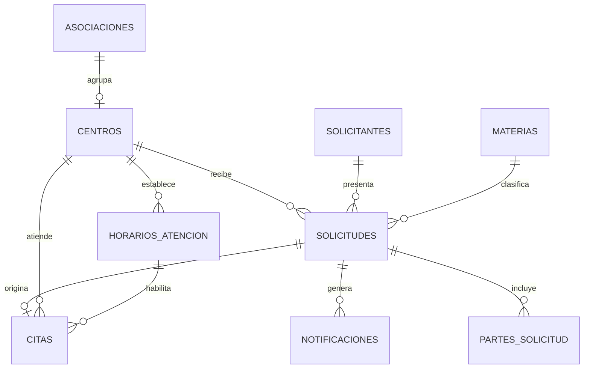
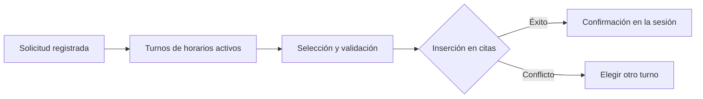

# Manual técnico de SELEGAL

**Centro de Conciliación Extrajudicial**  
Documentación académica de Ingeniería de Sistemas  
Instalación, arquitectura, operación y mantenimiento

## 1 Portada

- Proyecto: SELEGAL
- Aplicación: `selegal-app/`
- Revisión de referencia: `a79a976`, con cambios locales preexistentes en `public/assets/app.js`
- Fecha de revisión: 20 de noviembre de 2026

Los datos de autoría, universidad, curso y docente están pendientes de identificación.

<!-- contents -->

### Índice

1. [Portada](#1-portada)
2. [Introducción](#2-introducción)
3. [Objetivo general y objetivos específicos](#3-objetivo-general-y-objetivos-específicos)
4. [Descripción general del sistema](#4-descripción-general-del-sistema)
5. [Alcance del proyecto](#5-alcance-del-proyecto)
6. [Requisitos técnicos de hardware y software](#6-requisitos-técnicos-de-hardware-y-software)
7. [Tecnologías y herramientas utilizadas](#7-tecnologías-y-herramientas-utilizadas)
8. [Arquitectura del sistema](#8-arquitectura-del-sistema)
9. [Estructura de carpetas y archivos](#9-estructura-de-carpetas-y-archivos)
10. [Diseño y estructura de la base de datos](#10-diseño-y-estructura-de-la-base-de-datos)
11. [Descripción técnica de los módulos](#11-descripción-técnica-de-los-módulos)
12. [Clases, funciones y componentes principales](#12-clases-funciones-y-componentes-principales)
13. [Funcionamiento interno de los procesos](#13-funcionamiento-interno-de-los-procesos)
14. [Instalación y configuración del entorno](#14-instalación-y-configuración-del-entorno)
15. [Configuración y conexión de la base de datos](#15-configuración-y-conexión-de-la-base-de-datos)
16. [Procedimiento para ejecutar el sistema](#16-procedimiento-para-ejecutar-el-sistema)
17. [Seguridad y validaciones implementadas](#17-seguridad-y-validaciones-implementadas)
18. [Mantenimiento y solución de errores frecuentes](#18-mantenimiento-y-solución-de-errores-frecuentes)
19. [Conclusiones](#19-conclusiones)
20. [Anexos técnicos](#20-anexos-técnicos)

<!-- page -->

## 2 Introducción

SELEGAL es una aplicación web para un centro de conciliación extrajudicial. El sitio público presenta los servicios del centro, admite solicitudes en materia civil y familiar y permite reservar una cita. El personal utiliza un panel privado para revisar solicitudes, administrar citas y horarios, editar contenidos y gestionar accesos.

Este manual está dirigido a quien instale, evalúe o mantenga la aplicación. Describe el código PHP, las rutas, las vistas, los recursos del navegador, el esquema SQL, las migraciones y las pruebas. La referencia principal es el código que atiende las rutas actuales. Los archivos heredados se identifican allí donde afectan la instalación o la verificación.

## 3 Objetivo general y objetivos específicos

**Objetivo general.** Documentar la implementación de SELEGAL para reproducir su instalación local, comprender sus flujos y diagnosticar fallos a partir de los componentes que los originan.

**Objetivos específicos**

- Identificar dependencias, puntos de entrada, controladores y vistas que intervienen en cada módulo.
- Explicar las relaciones y restricciones del esquema MySQL, así como la instalación complementaria de permisos.
- Describir el recorrido de una solicitud y una cita desde el formulario hasta su gestión en el panel.
- Precisar los controles de acceso, las validaciones y los límites operativos observados.

## 4 Descripción general del sistema

| Actor | Operaciones disponibles |
| --- | --- |
| Visitante | Consulta información pública, registra una solicitud y reserva desde la misma sesión. |
| Personal autenticado | Entra al panel. Sus permisos determinan qué módulos puede utilizar. |
| Administrador | Administra usuarios, roles y permisos. Con la asignación inicial dispone de todos los permisos funcionales. |

`SiteController::center()` toma el primer registro de `centros` identificado como `SELEGAL`. Los ajustes de contacto se leen de ese registro. El esquema admite varios centros, pero la aplicación revisada carece de selector de centro y sus consultas administrativas de casos tienen alcance global en la base.

## 5 Alcance del proyecto

El alcance abarca información institucional, recepción de solicitudes, reserva y seguimiento de citas, constancia imprimible, gestión de disponibilidad semanal, contenidos y control de accesos. WhatsApp se utiliza mediante enlaces. El aviso de nueva solicitud al centro puede enviarse por correo cuando se configura un transporte efectivo.

La implementación llega hasta la coordinación de citas. Quedan fuera del flujo disponible la tramitación integral de expedientes y actas, la asignación individual a conciliadores, los pagos, el registro público de cuentas y la recuperación de contraseña desde el portal. La confirmación pública se abre con la sesión de reserva. Los cambios de cita se gestionan en el panel.

<!-- page -->

## 6 Requisitos técnicos de hardware y software

| Recurso | Requisito comprobable |
| --- | --- |
| Equipo de desarrollo o servidor | Capacidad para ejecutar PHP y MySQL, con espacio para dependencias, base, registros, fotos y respaldos. El proyecto carece de mediciones que permitan fijar mínimos de CPU, RAM o disco. |
| PHP | PHP 8.4.1 o posterior compatible con el bloqueo actual. `composer.json` declara `^8.3` y los paquetes Symfony 8.1 fijados exigen PHP 8.4.1 como mínimo. Habilitar PDO y `pdo_mysql`. |
| Composer | Gestor requerido para restaurar `vendor/` desde `composer.lock`. Comprobar la plataforma con `composer check-platform-reqs`. |
| MySQL | MySQL 8.0.16 o posterior para que se apliquen las restricciones `CHECK` del SQL. Requiere InnoDB, `utf8mb4` y soporte de columnas generadas. |
| Cliente web | Navegador con cookies, JavaScript, Canvas 2D y soporte de impresión para los flujos que los usan. |
| Node.js y npm | Opcionales para compilar con Vite. Vite 8 requiere Node.js 20.19+ en la rama 20 o 22.12+ desde la rama 22. |
| Pruebas incluidas | `pdo_sqlite` para la configuración de PHPUnit en memoria. Una comprobación integral del flujo de citas requiere MySQL. |
| Dispositivos y servicios opcionales | Impresora térmica de 80 mm para el ticket, cliente MySQL Workbench para administrar datos y servidor de correo para avisos efectivos. |

Se encontraron PHP 8.4.26 y Composer 2.10.3 en el entorno de revisión. La herramienta de compilación solo interviene si se usan las entradas de `resources/`. Las vistas activas enlazan directamente los recursos de `public/assets/`. Véanse las referencias de compatibilidad del anexo E.

## 7 Tecnologías y herramientas utilizadas

| Tecnología | Versión o declaración | Uso en el proyecto |
| --- | --- | --- |
| PHP y Laravel | PHP `^8.3`, Laravel `^13.17`, fijado en `v13.40.0` | Rutas, middleware, controladores, validación, sesiones, correo y consola Artisan. |
| Blade, HTML y CSS | Blade incluido en Laravel | Renderizado en servidor, formularios y estilos adaptables. |
| JavaScript y Canvas 2D | JavaScript del navegador | Agenda interactiva, filtros, paginación y balanza en perspectiva. |
| MySQL y PDO | SQL provisto en el repositorio | Persistencia de datos del centro y control de integridad. |
| Query Builder y Eloquent | Incluidos en Laravel | Query Builder para el dominio. Eloquent para `User` y los modelos de Spatie. |
| Spatie Laravel Permission | `^6.0`, fijado en `6.25.0` | Roles, permisos y relaciones polimórficas con usuarios. |
| Carbon y Tinker | `3.15.1` y `v3.0.2` fijados | Cálculo de disponibilidad y fechas. Tinker brinda una consola interactiva. |
| Vite y Tailwind CSS | `^8.0.0` y `^4.0.0` | Canal de compilación de la plantilla. El manifiesto declara rangos y carece de un archivo de bloqueo npm versionado. |
| PHPUnit | `^12.5.12`, fijado en `12.5.43` | Pruebas unitarias y de integración HTTP. |

<!-- page -->

## 8 Arquitectura del sistema

SELEGAL se ejecuta como una aplicación Laravel monolítica. `public/index.php` carga el autoloader de Composer y `bootstrap/app.php`. Este último enlaza las rutas web y de consola, expone `/up` y registra los alias de middleware de Spatie. El grupo web aporta sesión y protección CSRF. `AppServiceProvider` está registrado y sus métodos `register()` y `boot()` carecen de lógica personalizada.



**Figura 1.** Componentes que participan en una petición web.

- **Presentación.** `site.blade.php` selecciona la página mediante `$page`, incorpora parciales y renderiza el contenido en servidor. JavaScript mejora la interacción con el HTML ya entregado.
- **Aplicación.** `SiteController` coordina las páginas públicas y las funciones del panel. `AccessController` administra roles y permisos. Ambos realizan operaciones sobre datos desde el controlador.
- **Datos.** Las solicitudes, citas y contenidos se leen y escriben con `DB::table()`. `User` enlaza la autenticación con `usuarios`. El acceso por roles utiliza los modelos `Role` y `Permission` de Spatie.
- **Integraciones.** Laravel Mail usa el transporte configurado. Los enlaces `wa.me` abren WhatsApp en el cliente. El navegador procesa el ticket y carga tipografías públicas cuando puede acceder a Google Fonts.

El proyecto registra rutas web y comandos Artisan. La regla de `bootstrap/app.php` para responder errores en JSON ante `api/*` o peticiones que lo esperan es una configuración de excepciones. El árbol revisado carece de rutas de API de negocio.

<!-- page -->

## 9 Estructura de carpetas y archivos

Las rutas de esta tabla son relativas a `selegal-app/`. En la raíz superior, `README.md` identifica el repositorio y `.gitignore` regula exclusiones generales.

| Ruta | Responsabilidad |
| --- | --- |
| `app/Http/Controllers/` | `Controller.php` es la clase base. `SiteController.php` reúne portal y administración. `AccessController.php` implementa gestión de accesos. |
| `app/Models/User.php` | Modelo Eloquent autenticable asociado a `usuarios`. |
| `app/Providers/`, `bootstrap/` | Proveedor de servicios, arranque, middleware y caché de arranque. |
| `routes/web.php`, `routes/console.php` | Contrato HTTP y comandos SELEGAL. |
| `config/` | Aplicación, autenticación, permisos, conexión, cookies y sesión, correo, almacenamiento, caché, cola, registros y servicios. |
| `database/selegal_db.sql` | DDL operativo para MySQL, datos iniciales y consultas de comprobación. |
| `database/migrations/` | Migraciones base de Laravel, prototipo de dominio y tablas de Spatie. |
| `database/seeders/`, `database/factories/` | `AccessSeeder` inicializa permisos. `DatabaseSeeder` y `UserFactory` pertenecen al andamiaje heredado. |
| `resources/views/` | Vista central, parciales públicos, gestión de accesos, ticket y bienvenida de plantilla. |
| `resources/css/`, `resources/js/` | Entradas de Vite. CSS con Tailwind y JavaScript de plantilla. |
| `public/` | Raíz web, `index.php`, `.htaccess`, `robots.txt`, icono, imágenes y recursos activos. |
| `public/uploads/members/` | Directorio local para fotografías cargadas. Se crea si hace falta y Git lo ignora. |
| `storage/`, `bootstrap/cache/` | Archivos de sesión, caché, vistas compiladas, registros y otros datos de ejecución. |
| `tests/`, `phpunit.xml` | Suites Feature y Unit con SQLite en memoria como configuración de pruebas. |
| `composer.json`, `composer.lock`, `vendor/` | Dependencias PHP, versiones fijadas y paquetes instalados. `vendor/` se regenera con Composer. |
| `package.json`, `.npmrc`, `vite.config.js` | Dependencias y compilación frontal. npm usa `ignore-scripts=true` y `audit=true`. |
| `.env.example`, `.env`, `.gitignore` | Plantilla, configuración privada del entorno y exclusiones del repositorio. |
| `README.md`, `MANUAL-TECNICO.md`, `MANUAL-USUARIO.md`, `docs/` | Guías preexistentes de arranque y uso, y las dos versiones de este manual en `docs/`. |
| `AGENTS.md`, `CLAUDE.md` | Orientación para agentes de desarrollo. Laravel Boost forma parte de esa orientación y no es dependencia del sitio. |

`public/assets/` contiene el CSS principal, `app.js`, `balanza-3d.js`, `escudo.jpg` y `balanza-selegal.png`. Los archivos de configuración del editor y de atributos de Git se encuentran en la raíz de la aplicación. La vista `welcome.blade.php` de Laravel no está enlazada por las rutas actuales.

<!-- page -->

## 10 Diseño y estructura de la base de datos

MySQL crea `selegal_db` con `utf8mb4_unicode_ci`. El SQL declara quince tablas de negocio InnoDB, claves primarias numéricas sin signo y claves foráneas donde corresponde. La carga inicial crea la asociación, el centro SELEGAL y el catálogo de materias y servicios. Horarios, credenciales de acceso y casos se incorporan después.

### 10.1 Diccionario del esquema operativo

| Tabla | Campos y restricciones principales | Uso |
| --- | --- | --- |
| `asociaciones` | `id`, `nombre` único, `descripcion`, marcas de tiempo. | Entidad institucional vinculada al centro por el SQL. |
| `centros` | `asociacion_id` único y FK, nombres, resolución, contacto, dirección y banderas de acreditación y publicación. | Identificación y configuración del centro. |
| `usuarios` | `nombre`, `usuario` único, `email` único, `password`, `rol`, `activo` y marcas de tiempo. | Identidad y estado de la cuenta. |
| `materias` | `id`, `nombre` único, `descripcion`. | Catálogo Civil y Familiar. |
| `equipo` | FK `centro_id`, nombre, cargo, descripción, foto, `visible`, marcas de tiempo. | Integrantes del centro. |
| `equipo_materias` | FK `equipo_id` y `materia_id`, par único. | Relación de especialidades prevista en SQL. |
| `servicios` | FK a centro y materia, nombre, descripción, activo y orden. Nombre único por centro. | Catálogo cargado por SQL. La vista activa tiene texto fijo. |
| `testimonios` | FK `centro_id`, `nombre_cliente`, `contenido`, `visible`, `fecha_registro`. | Testimonios administrables y selección pública. |
| `redes_sociales` | FK `centro_id`, plataforma, URL, visibilidad. Par centro y plataforma único. | Catálogo previsto en SQL. |
| `solicitantes` | Nombre, teléfono, correo y marcas de tiempo. | Identificación del contacto de la solicitud. |
| `solicitudes` | FK a centro, solicitante y materia, descripción, estado, campos de consentimiento y fecha. Índices por estado y fecha. | Registro de petición de conciliación. |
| `partes_solicitud` | FK `solicitud_id`, nombre, DNI, teléfono y dirección. | Estructura para partes adicionales, sin formulario activo. |
| `horarios_atencion` | FK `centro_id`, día ISO, inicio, fin, duración y activo. Rango único por centro y día. | Disponibilidad semanal. |
| `citas` | FK a solicitud, centro y horario, fecha, inicio, fin, estado, observación, marcas de tiempo y `slot_activo`. | Reserva única por solicitud y bloqueo del turno. |
| `notificaciones` | FK `solicitud_id`, tipo, canal, destinatario, texto, estado y fechas. Índice por estado. | Registro interno y seguimiento del aviso por correo. |

<!-- page -->

### 10.2 Relaciones e integridad



**Figura 2.** Relaciones principales del flujo de solicitudes y citas. En el resto del esquema, `centros` se vincula con equipo, testimonios, servicios y redes sociales. `equipo_materias` relaciona perfiles de equipo y materias. `servicios` también referencia a `materias`.

- `citas.solicitud_id` es único. Incluso cancelada, una cita sigue siendo el registro asociado a su solicitud.
- `slot_activo` es una columna generada y almacenada. Usa fecha e inicio para estados distintos de `CANCELADA` y devuelve `NULL` para las canceladas. El índice único `uk_cita_horario` impide que dos citas no canceladas compartan centro, fecha y hora de inicio. La regla compara el inicio del turno y carece de una comprobación general por solapamiento de intervalos.
- Los `CHECK` validan día semanal, orden de horas, duración positiva y publicación de dirección acreditada. Las claves foráneas restringen la mayoría de eliminaciones. La eliminación de un integrante borra sus vínculos en `equipo_materias` y la eliminación de una solicitud borra sus filas de `partes_solicitud` si las demás referencias lo permiten.

### 10.3 Tablas complementarias de permisos

| Tabla | Campos clave y función |
| --- | --- |
| `roles` | `id`, `name`, `guard_name`, marcas de tiempo. Nombre único por guard. |
| `permissions` | Misma estructura de identificación. Catálogo de permisos. |
| `model_has_roles` | `role_id`, `model_type`, `model_id`. Asocia roles a instancias de modelos. |
| `model_has_permissions` | `permission_id`, `model_type`, `model_id`. Estructura para permisos directos. |
| `role_has_permissions` | `permission_id`, `role_id`. Asocia permisos a roles. |

Las tablas provienen de la migración de Spatie. Los pivotes tienen claves compuestas, FK hacia roles o permisos y borrado en cascada en esos vínculos. `model_id` es polimórfico y carece de FK hacia `usuarios`. El guard usado es `web` y la opción `teams` de Spatie está desactivada. Laravel registra la migración aplicada en `migrations`.

<!-- page -->

## 11 Descripción técnica de los módulos

| Módulo | Implementación | Datos o salida |
| --- | --- | --- |
| Portal público | `SiteController` y los parciales `section-*` presentan inicio, servicios, proceso, equipo, testimonios y contacto. | Equipo y testimonios visibles, ajustes de `centros` y contenido fijo en Blade. |
| Solicitudes | `requestStore()` recibe el formulario. `requests()` y `contacted()` gestionan la bandeja y la marca de contacto. | `solicitantes`, `solicitudes`, `materias` y `notificaciones`. |
| Citas | `schedule()`, `book()`, `booked()`, `appointments()`, `adminBook()` y `appointmentStatus()`. | Turnos disponibles, reserva, confirmación pública y estados administrativos. |
| Ticket | `ticket()` renderiza `ticket.blade.php`. | Constancia HTML de 80 mm con ID, datos de cita y código Code 39 en SVG. |
| Horarios | `availability()` y `saveAvailability()` editan la disponibilidad por día semanal. | Rangos en `horarios_atencion` y vista previa de turnos. |
| Contenido administrable | Acciones del equipo, testimonios y datos de contacto. | Altas y edición, borrado de integrantes, visibilidad de testimonios y fotografías del equipo. |
| Autenticación y panel | `authenticate()`, `logout()`, `dashboard()` y `User`. | Sesión, resumen de solicitudes y citas y enlaces según permisos. |
| Administración de accesos | `AccessController`, `users()`, `saveUser()` y `AccessSeeder`. | Alta de cuentas y gestión de roles, permisos y asignaciones. |
| Avisos de solicitudes | `requestStore()` registra el aviso interno y `notifyRequest()` gestiona el aviso por correo. | Estado de envío en `notificaciones`. |

## 12 Clases funciones y componentes principales

### 12.1 Controlador del portal y modelo de usuario

| Función o clase | Responsabilidad |
| --- | --- |
| `center()`, `view()`, `admin()` | Resuelven el centro y construyen la vista con `$page`, preferencias públicas y datos específicos. |
| `requestsQuery()`, `appointmentsQuery()` | Unen los datos operativos y proyectan alias usados por Blade. La hora de la cita se formatea con `TIME_FORMAT()` de MySQL. |
| `members()`, `reviews()` | Filtran por centro y proyectan los campos que consumen las secciones públicas y el panel. |
| `slots()`, `reserve()` | El primero calcula turnos visibles. El segundo valida un inicio contra un rango activo e inserta una cita. |
| `User` | Extiende `Authenticatable`, usa `Notifiable` y `HasRoles`, declara campos editables, oculta `password` y convierte `activo` a booleano. `getNameAttribute()` expone `nombre` como `name`. El cast `hashed` asegura hash y `getRememberTokenName()` desactiva ese token. |

<!-- page -->

### 12.2 Acciones de gestión y autorización

| Componente | Comportamiento |
| --- | --- |
| `dashboard()`, `requests()` y `contacted()` | Cuentan solicitudes pendientes y próximas citas en estados seleccionados, obtienen hasta cinco solicitudes recientes, listan casos y marcan un caso como `EN_REVISION`. El detalle se selecciona con `?ver=ID`. |
| `adminTeam()`, `saveMember()`, `deleteMember()` | Listan, insertan, actualizan y eliminan integrantes del centro. La edición se abre con `?editar=ID`. La foto opcional recibe un nombre UUID y se mueve a `public/uploads/members/`. |
| `adminTestimonials()`, `saveTestimonial()`, `toggleTestimonial()` | Listan y permiten crear, editar o alternar visibilidad. La vista ofrece conservar un testimonio oculto. |
| `adminContact()`, `saveContact()` | Actualizan correo, dirección, visibilidad y el mismo número para teléfono y WhatsApp. La acreditación se lee del centro existente. |
| `users()`, `saveUser()` | Listan cuentas y crean una nueva con un rol inicial entre los tres del sistema. `usuario` recibe un identificador aleatorio. `usuarios.rol` registra `ADMINISTRADOR` o `PERSONAL`. |
| `AccessController::index()` | Carga roles, permisos y usuarios con sus relaciones. Delega en el parcial `access.blade.php`. |
| `saveRole()`, `deleteRole()` | Crean, editan y sincronizan permisos del rol. La eliminación aplica a roles web sin asignaciones y que no están protegidos. |
| `savePermission()`, `assign()` | Crean o editan el nombre de un permiso y sincronizan los roles de la cuenta elegida. `assign()` opera sobre la relación de Spatie y deja el campo `usuarios.rol` con su valor anterior. |

### 12.3 Vistas y comportamiento del navegador

`site.blade.php` sirve tanto al portal como al panel. Usa cinco parciales `section-*` para contenido público y `access.blade.php` para accesos. `ticket.blade.php` genera un documento independiente. El ticket rellena el ID de cita con ceros hasta un mínimo de ocho dígitos, construye las barras y llama a `window.print()` al pulsar Imprimir.

`public/assets/app.js` controla el menú móvil, actualiza las horas a partir de `window.availableSlots`, señala campos obligatorios, filtra y pagina localmente los listados con diez filas por página y alterna entre solicitud nueva y existente en la reserva administrativa. El buscador de usuarios en gestión de accesos también normaliza mayúsculas y acentos. Los registros de los listados se entregan en HTML antes de filtrarse.

`balanza-3d.js` dibuja la balanza en Canvas 2D. `mount()`, `surface()`, `turn()`, `tube()`, `path()` y `loop()` construyen superficies, piezas de revolución y tubos. El cálculo de perspectiva y los eventos de puntero permiten rotar la figura. Los estilos y la imagen de respaldo pertenecen a los recursos públicos.

<!-- page -->

## 13 Funcionamiento interno de los procesos

### 13.1 Recepción y aviso de una solicitud

1. `GET /solicitar` muestra el formulario. `POST /solicitar` valida nombre, teléfono, correo, materia y descripción.
2. En una transacción se inserta un solicitante, se identifica la materia por nombre, se crea la solicitud con el estado por defecto `PENDIENTE` y se registra `NUEVA_SOLICITUD` en el canal `SISTEMA`.
3. Después de confirmar la transacción, `notifyRequest()` agrega un registro `EMAIL` con estado `PENDIENTE`. Si hay destinatario y un transporte distinto de `log` y `array`, intenta enviar un mensaje al centro. Registra `ENVIADA` y `fecha_envio` en caso de éxito o `FALLIDA` y reporta la excepción si el envío lanza un error. Con el transporte de ejemplo, el registro queda pendiente.
4. Se guarda `request_id` en sesión y se redirige a `/solicitud-enviada`. La sesión habilita el acceso a `/agendar`. La bandeja muestra `Pendiente` para `PENDIENTE` y `Contactado` para cualquier otro estado. La acción de contacto escribe `EN_REVISION`.

### 13.2 Generación y reserva de un turno



**Figura 3.** Reserva pública a partir de una solicitud con sesión activa.

`slots()` recorre hoy y los siguientes 59 días, según `America/Lima`. Recorre los rangos semanales activos en pasos de `duracion_minutos`, conserva comienzos futuros y excluye los horarios ocupados por citas que no estén canceladas. El formulario muestra los turnos agrupados por día. `reserve()` vuelve a comprobar que la hora se alinee con el inicio del rango, que toda la cita quepa y que el turno sea futuro. El alcance de 60 días corresponde al listado visible. La función de inserción valida el rango semanal y el carácter futuro del turno.

La transacción inserta `CONFIRMADA`. Un conflicto de unicidad produce un mensaje de disponibilidad. Al confirmar, se borra `request_id`, se guarda `appointment_id` y se redirige a la pantalla con fecha, hora y materia.

### 13.3 Registro administrativo y cambios de estado

`adminBook()` recibe `mode=existing` o `mode=new`. En el primer modo comprueba la existencia de la solicitud del centro. En el segundo crea solicitante y solicitud dentro de la misma transacción que reserva el turno. La cita administrativa creada en modo nuevo sigue ese flujo sin invocar `notifyRequest()` ni insertar el aviso interno del formulario público.

`appointmentStatus()` bloquea la fila de la cita durante la transacción. Puede guardar `PENDIENTE`, `CONFIRMADA`, `CANCELADA` o `FINALIZADA`, o almacenar una fecha, hora y horario nuevos al reprogramar como `REAGENDADA`. La reprogramación verifica la selección contra `slots()`. Al cancelar se libera el turno, pero se conserva la cita y su relación con la solicitud. Para gestionar esa misma cita se utiliza el cambio de estado correspondiente.

<!-- page -->

### 13.4 Efecto de modificar la disponibilidad

`saveAvailability()` recibe el día ISO, lunes 1 a domingo 7, y un par de horas `HH:mm`. Si se indica un rango, su fin debe ser posterior al inicio y el intervalo debe durar al menos 60 minutos. Dentro de una transacción desactiva los rangos de ese día y activa o crea el rango elegido, con turnos de 60 minutos. El par `00:00` y `00:00` cierra el día. Las citas que ya referencian un horario conservan ese registro incluso si se desactiva.

## 14 Instalación y configuración del entorno

Aplicar este procedimiento sobre una instalación nueva de desarrollo. Si ya existe una base, verificar su esquema y respaldarla antes de ejecutar instaladores o migraciones. Ejecutar los comandos desde la raíz de la aplicación.

### 14.1 Verificar y restaurar dependencias

```powershell
Set-Location .\selegal-app
php -v
composer -V
php -m | Select-String 'PDO|pdo_mysql|pdo_sqlite'
composer install
composer check-platform-reqs
```

`composer install` restaura las versiones fijadas y ejecuta el descubrimiento de paquetes. `pdo_sqlite` es necesario para la suite configurada en `phpunit.xml`. La plataforma de la aplicación necesita `pdo_mysql`.

### 14.2 Preparar una configuración local nueva

```powershell
if (-not (Test-Path -LiteralPath '.env')) {
    Copy-Item -LiteralPath '.env.example' -Destination '.env'
    php artisan key:generate
}
```

Si el archivo ya existe, conservarlo y verificar que `APP_KEY` esté definido. Generar la clave solo para una instalación nueva o una configuración nueva sin clave. Mantener permisos de escritura para el proceso PHP en `storage/` y `bootstrap/cache/`. Para cargar fotos, el proceso debe poder crear o escribir en `public/uploads/members/`.

### 14.3 Compilación opcional de la plantilla

```powershell
node -v
npm.cmd --version
npm.cmd install --ignore-scripts
npm.cmd run build
```

En PowerShell se usa `npm.cmd` para llamar al ejecutable de npm. Vite compila `resources/css/app.css` y `resources/js/app.js`, y el plugin Laravel Vite configura la fuente Instrument Sans. El portal activo toma sus recursos de `public/assets/`; el procedimiento principal puede ejecutarse con PHP, Composer y MySQL. `composer setup` invoca migraciones generales y requiere npm, por lo que se emplean los pasos explícitos de este manual para SELEGAL.

El bloqueo de desarrollo fija FakerPHP 1.24.1, Mockery 1.6.15, Collision 8.9.5, Pail 1.2.7, Pao 1.1.5 y Pint 1.32.1. npm declara el plugin de Laravel para Vite, el plugin de Tailwind, Concurrently y la dependencia opcional Multiplex.

<!-- page -->

## 15 Configuración y conexión de la base de datos

### 15.1 Ajustar las variables de entorno

Iniciar el servicio MySQL. Editar `.env` con los datos de la instancia de desarrollo y una cuenta habilitada para la fase de instalación. Los marcadores del bloque se sustituyen localmente.

```dotenv
APP_NAME=SELEGAL
APP_ENV=local
APP_DEBUG=true
APP_URL=http://127.0.0.1:8017
DB_CONNECTION=mysql
DB_HOST=127.0.0.1
DB_PORT=3306
DB_DATABASE=selegal_db
DB_USERNAME=<usuario_mysql>
DB_PASSWORD=<contraseña_mysql>
SESSION_DRIVER=file
CACHE_STORE=file
QUEUE_CONNECTION=sync
MAIL_MAILER=log
```

`config/database.php` obtiene la conexión por defecto de `DB_CONNECTION`. También admite `DB_URL`, de modo que una URL residual puede alterar la conexión usada por Eloquent y el Query Builder. El instalador de SELEGAL monta su propio DSN a partir de host, puerto, usuario y contraseña. El SQL contiene `CREATE DATABASE IF NOT EXISTS selegal_db` y `USE selegal_db`, de modo que modificar únicamente `DB_DATABASE` no cambia el destino de la importación.

La configuración de ejemplo conserva sesión y caché en archivos, con sesiones de 120 minutos y cola síncrona. Así, el arranque habitual prescinde de las tablas auxiliares de Laravel para esos almacenes. La zona horaria se establece en `config/app.php`. La plantilla de entorno declara `APP_LOCALE=en`, aunque los textos propios del sitio están escritos en español.

### 15.2 Importar el dominio e inicializar accesos

```powershell
php artisan config:clear
php artisan selegal:instalar-db
php artisan migrate --path=database/migrations/2026_11_11_135102_create_permission_tables.php
php artisan db:seed --class=AccessSeeder
php artisan selegal:admin
```

1. `selegal:instalar-db` conecta a MySQL por PDO, separa el archivo SQL por punto y coma, quita comentarios de línea y omite las sentencias diagnósticas `SELECT` y `SHOW`. Ejecutar el archivo SQL completo en MySQL Workbench es una vía equivalente para cargar el esquema y las semillas. El usuario de instalación necesita privilegios para crear la base y sus tablas.
2. Aplicar la migración de Spatie cuando sus cinco tablas todavía estén pendientes de instalar. Revisar `php artisan migrate:status` y las tablas existentes antes de actuar sobre una base en uso.
3. `AccessSeeder` asegura que los roles y permisos del sistema existan. Concede los permisos iniciales únicamente al crear cada rol. La orden de alta del administrador pide nombre, correo y contraseña mediante entrada oculta y asigna el rol `ADMINISTRADOR`.

Las migraciones `2026_01_01_*` y `2026_01_02_*` operan sobre tablas heredadas como `requests` y `appointments`. SQLite sirve para las pruebas configuradas, mientras que el dominio activo depende del esquema MySQL y de expresiones como `TIME_FORMAT()`. El inicializador `DatabaseSeeder` genérico invoca una fábrica que el `User` actual no expone. Para el alta usar `selegal:admin` o el panel.

<!-- page -->

## 16 Procedimiento para ejecutar el sistema

### 16.1 Iniciar y comprobar el entorno local

```powershell
php artisan db:show
php artisan route:list --except-vendor
php artisan serve --host=127.0.0.1 --port=8017
```

1. Abrir `http://127.0.0.1:8017/` y revisar la portada pública. `http://127.0.0.1:8017/up` comprueba el arranque de Laravel. `db:show` y el acceso a la portada complementan esa prueba para la base de datos.
2. Entrar en `http://127.0.0.1:8017/admin/login` con la cuenta creada y abrir **Horarios**. Registrar un rango futuro que permita generar al menos un turno.
3. Abrir una sesión separada para simular a un visitante de prueba. Registrar una solicitud ficticia, seguir el enlace de agenda y confirmar un turno disponible.
4. Volver al panel, localizar la solicitud y la cita, comprobar el estado y abrir la constancia imprimible. En una impresora térmica, validar las dimensiones y legibilidad del código con el controlador de impresión real.

Mantener estable el host de acceso durante la prueba porque la reserva depende de la cookie de sesión. Se puede detener el servidor de desarrollo con `Ctrl+C`.

### 16.2 Configurar el correo cuando se necesite

```dotenv
MAIL_MAILER=smtp
MAIL_SCHEME=<esquema_del_proveedor>
MAIL_HOST=<servidor_smtp>
MAIL_PORT=<puerto_smtp>
MAIL_USERNAME=<usuario_smtp>
MAIL_PASSWORD=<contraseña_smtp>
MAIL_FROM_ADDRESS=<remitente_autorizado>
MAIL_FROM_NAME=SELEGAL
```

Seguir la configuración del proveedor, limpiar la caché de configuración y guardar el correo receptor en Contacto. Validar con una solicitud ficticia y consultar `notificaciones` y los registros de Laravel. El sistema solo intenta enviar el aviso de nueva solicitud al correo del centro. La constancia y la confirmación pública se muestran en pantalla.

### 16.3 Consideraciones de despliegue

Para un despliegue, apuntar la raíz web a `public/`, proporcionar HTTPS, usar `APP_DEBUG=false`, definir la URL pública y proteger `.env`. Configurar el acceso a MySQL con los privilegios requeridos por cada fase y conservar una `APP_KEY` estable. El repositorio contiene `.htaccess` para Apache. El servidor de producción, el dominio real, el proveedor SMTP y la capacidad de carga sostenida no quedan acreditados por el código.

<!-- page -->

## 17 Seguridad y validaciones implementadas

### 17.1 Controles efectivos

| Control | Implementación |
| --- | --- |
| Inicio de sesión | `Auth::attempt()` con correo, contraseña y `activo=1`. La sesión se regenera al entrar. El cierre invalida la sesión y regenera el token CSRF. |
| CSRF y frecuencia | Los formularios POST incluyen `@csrf`. `POST /solicitar` limita a 10 intentos por minuto y `POST /admin/login` a 5. |
| Permisos | El grupo `/admin` exige `auth`. Roles y permisos de Spatie protegen rutas y los controles de Blade adaptan el menú. |
| Contraseñas | Hash por modelo y por `Hash::make()` en el alta web. Alta web con contraseña confirmada de al menos 12 caracteres. Alta CLI con entrada oculta y longitud mínima de 12. |
| Solicitudes | Nombre hasta 150, teléfono hasta 20, correo válido hasta 150 y descripción hasta 3000 caracteres. Materia limitada a Civil o Familiar. El teléfono se valida como cadena. |
| Citas y horarios | Estado administrativo por lista, fecha desde hoy, hora `H:i`, validez posterior dentro del rango y protección de unicidad en la base. |
| Contenido | Cargo de equipo limitado a tres valores, foto tipo imagen hasta 2048 KB, descripción de integrante hasta 2000 caracteres y testimonio hasta 1000. Dirección publicable solo si está acreditada y tiene texto. |
| Gestión de accesos | Roles del sistema protegidos frente a renombrado o borrado. Los permisos del sistema no se renombran. El administrador conserva `accesos gestionar` en el rol del sistema y una sesión administrativa no puede quitarse su propio rol al asignar. |

### 17.2 Matriz de autorización inicial

| Rol | Asignación al crear con `AccessSeeder` |
| --- | --- |
| `ADMINISTRADOR` | `accesos gestionar`, `solicitudes ver`, `citas gestionar`, `contenido gestionar` y `horarios gestionar`. Usuarios y accesos se protegen por el rol. |
| `RECEPCIONISTA` | `solicitudes ver` y `citas gestionar`. La primera autorización también habilita marcar como contactado. |
| `CONCILIADOR` | Sin permisos iniciales de módulos. El controlador impide asignar al rol homónimo los permisos de solicitudes y citas. |

### 17.3 Límites que afectan la operación

Las autorizaciones de solicitudes y citas operan por módulo. El panel general oculta el resumen solo cuando la cuenta carece de ambos permisos. Con cualquiera de los dos, la vista presenta los dos contadores y la actividad reciente de solicitudes. La autorización de cada ruta administrativa específica se comprueba por separado.

La interfaz de accesos asigna roles a usuarios y permisos a roles. Los permisos personalizados solo generan un efecto en la aplicación si algún control los consulta. El esquema prevé `acepta_tratamiento_datos` y `fecha_consentimiento`, pero el formulario público y el flujo de alta no recogen esos valores. Tampoco se identifica un historial dedicado de auditoría de cambios en los módulos revisados.

<!-- page -->

## 18 Mantenimiento y solución de errores frecuentes

### 18.1 Diagnóstico operativo

| Síntoma | Causa a comprobar | Acción |
| --- | --- | --- |
| `could not find driver` | CLI o servidor web sin `pdo_mysql`. | Revisar `php --ini`, `php -m` y el PHP del servidor web. |
| Conexión rechazada o acceso denegado | Servicio apagado, host o puerto distinto, credencial o privilegios incorrectos. | Revisar `.env`, limpiar caché de configuración y ejecutar `php artisan db:show`. |
| Faltan `centros` o `usuarios` | Esquema incompleto, base equivocada o uso de migraciones del prototipo. | Revisar el destino de `.env` y comprobar la importación SQL. |
| Portada devuelve 404 con Laravel iniciado | No se encuentra un centro con nombre comercial `SELEGAL`. | Comprobar el registro inicial en la base seleccionada. |
| Faltan roles o tablas de Spatie | Migración o `AccessSeeder` ausentes. | Revisar `migrate:status`, aplicar la migración específica cuando corresponda y verificar los roles efectivos. |
| 403 en una sección del panel | La sesión carece del rol o permiso de la ruta. | Revisar asignaciones y, si la caché está obsoleta, ejecutar `php artisan permission:cache-reset`. |
| 419 o pérdida del flujo público | Sesión o token expirado, cambio de host o cookies no persistentes. | Abrir un formulario nuevo con el mismo host y revisar `SESSION_DRIVER` y el directorio de sesiones. |
| Agenda vacía | Horario inactivo, día cerrado, intervalo agotado u horas pasadas. | Verificar rangos activos, día ISO, zona `America/Lima` y reservas ocupadas. |
| La cita rechaza una reserva | Horario ya reservado o solicitud con cita previa. | Volver a cargar la agenda y verificar el estado de la cita antes de elegir otro turno. |
| Aviso pendiente o fallido | Transporte `log` o `array`, correo del centro vacío o fallo del proveedor. | Revisar `MAIL_*`, destinatario, estado SQL y registros de Laravel. |
| Foto ausente tras el despliegue | Ruta pública, archivo o permisos de escritura incorrectos. | Revisar `public/uploads/members/`, `equipo.fotografia` y la raíz web. |

### 18.2 Cuidado de datos y activos

Respaldar MySQL y `public/uploads/members/` conjuntamente. Conservar la configuración privada en un respaldo protegido y comprobar la restauración en un entorno aislado. Los cambios del fichero SQL no transforman automáticamente instalaciones existentes porque los `CREATE TABLE IF NOT EXISTS` conservan las tablas previas. Comparar estructura e índices antes de aplicar cambios.

Revisar `storage/logs/` con el canal configurado y limpiar vistas o configuración si la caché conserva una versión anterior. Actualizar dependencias en un entorno de prueba y repetir el recorrido de instalación, agenda, permisos y ticket. La edición o eliminación de integrantes actúa sobre la fila y el código carece de una limpieza de fotografías anteriores. Cualquier depuración de archivos debe contrastarse con `equipo.fotografia` y los respaldos.

<!-- page -->

## 19 Conclusiones

SELEGAL integra un portal público y un panel administrativo sobre Laravel y MySQL. La aplicación persiste una solicitud, calcula turnos a partir de horarios recurrentes y delega en la base el control final de la unicidad de la reserva. La sesión enlaza el formulario, la agenda y la confirmación pública.

La operación de la agenda depende de disponer de un centro inicial, un catálogo de materias y horarios activos. La administración depende también de la migración de Spatie y de los roles y permisos configurados. La secuencia de instalación documentada refleja esas dependencias y la separación entre el esquema vigente y las migraciones heredadas.

Las capacidades verificadas corresponden a la recepción de solicitudes y coordinación de citas. El envío efectivo de correos, la impresión física, la capacidad para producción y el despliegue real requieren verificación en el entorno de destino.

## 20 Anexos técnicos

### A Rutas públicas y de autenticación

Laravel también atiende `HEAD` en las rutas declaradas con `GET`. La tabla usa los métodos principales del código.

| Método y ruta | Acción | Condición |
| --- | --- | --- |
| `GET /` | `home` | Pública |
| `GET /servicios` | `services` | Pública |
| `GET /proceso` | `process` | Pública |
| `GET /equipo` | `team` | Pública |
| `GET /testimonios` | `testimonials` | Pública |
| `GET /contacto` | `contact` | Pública |
| `GET /solicitar` | `requestForm` | Pública |
| `POST /solicitar` | `requestStore` | CSRF y límite 10 por minuto |
| `GET /solicitud-enviada` | `requestSuccess` | `request_id` en sesión |
| `GET /agendar` | `schedule` | `request_id` en sesión |
| `POST /agendar` | `book` | CSRF y `request_id` en sesión |
| `GET /cita-confirmada` | `booked` | Cita de la sesión localizable |
| `GET /admin/login` | `login` | Pública |
| `POST /admin/login` | `authenticate` | CSRF y límite 5 por minuto |
| `GET /up` | Ruta de salud de Laravel | Definida en `bootstrap/app.php` |

<!-- page -->

### B Rutas del panel administrativo

Cada ruta de la tabla exige autenticación. En los POST se aplica además CSRF. Los números de ruta `{id}` identifican filas de dominio y `{role}` y `{user}` se resuelven por vinculación del modelo Laravel.

| Método y ruta | Acción | Autorización adicional |
| --- | --- | --- |
| `GET /admin` | `dashboard` | Sesión autenticada |
| `POST /admin/salir` | `logout` | Sesión autenticada |
| `GET /admin/solicitudes` | `requests` | `solicitudes ver` |
| `POST /admin/solicitudes/{id}/contactado` | `contacted` | `solicitudes ver` |
| `GET /admin/citas` | `appointments` | `citas gestionar` |
| `POST /admin/citas` | `adminBook` | `citas gestionar` |
| `POST /admin/citas/{id}/estado` | `appointmentStatus` | `citas gestionar` |
| `GET /admin/citas/{id}/ticket` | `ticket` | `citas gestionar` |
| `GET /admin/horarios` | `availability` | `horarios gestionar` |
| `POST /admin/horarios` | `saveAvailability` | `horarios gestionar` |
| `GET /admin/equipo` | `adminTeam` | `contenido gestionar` |
| `POST /admin/equipo` | `saveMember` | `contenido gestionar` |
| `POST /admin/equipo/{id}/eliminar` | `deleteMember` | `contenido gestionar` |
| `GET /admin/testimonios` | `adminTestimonials` | `contenido gestionar` |
| `POST /admin/testimonios` | `saveTestimonial` | `contenido gestionar` |
| `POST /admin/testimonios/{id}/visibilidad` | `toggleTestimonial` | `contenido gestionar` |
| `GET /admin/contacto` | `adminContact` | `contenido gestionar` |
| `POST /admin/contacto` | `saveContact` | `contenido gestionar` |
| `GET /admin/usuarios` | `users` | Rol `ADMINISTRADOR` |
| `POST /admin/usuarios` | `saveUser` | Rol `ADMINISTRADOR` |
| `GET /admin/accesos` | `index` | Rol `ADMINISTRADOR` |
| `POST /admin/accesos/roles` | `saveRole` | Rol `ADMINISTRADOR` |
| `POST /admin/accesos/roles/{role}/eliminar` | `deleteRole` | Rol `ADMINISTRADOR` |
| `POST /admin/accesos/permisos` | `savePermission` | Rol `ADMINISTRADOR` |
| `POST /admin/accesos/usuarios/{user}` | `assign` | Rol `ADMINISTRADOR` |

<!-- page -->

### C Comandos de mantenimiento y pruebas

| Comando | Efecto y contexto |
| --- | --- |
| `php artisan selegal:casos-ejemplo` | Intenta crear 70 casos ficticios, desde un mes atrás hasta hoy, en una transacción. Se detiene si ya encuentra el prefijo de ejemplos. Puede crear rangos inactivos para asociar citas históricas. Usar en una base de pruebas. |
| `php artisan view:cache` | Compila las vistas Blade para verificar que puedan compilarse. |
| `php artisan config:clear` | Elimina la caché de configuración para recargar `.env`. |
| `php artisan migrate:status` | Consulta el historial de migraciones de la conexión activa. |
| `php artisan test --filter=AccessControlTest` | Ejecuta las pruebas de autorización con tablas creadas por la clase de prueba. |
| `php artisan test` | Ejecuta toda la suite del proyecto. La configuración de pruebas usa SQLite en memoria. |

### D Verificación y límites de las pruebas

`AccessControlTest` prepara un esquema reducido de usuarios, centros y permisos. Cubre restricciones por rol y permiso, la imposibilidad de retirar el propio rol administrativo y la apertura de gestión de accesos. `SelegalTest` intenta verificar páginas públicas, agenda y acceso al panel, pero usa `availability`, `appointments` y `User::factory()` propios de la implementación anterior. Su prueba con «ticket» en el nombre comprueba el acceso al panel sin consultar la ruta del ticket. `Feature/ExampleTest` depende de las migraciones generales para probar `/`. `Unit/ExampleTest` contiene una aserción de plantilla.

**Suite incluida.** En una copia aislada, pasaron 4 de 8 pruebas, incluidas las tres de accesos. Las cuatro restantes fallaron por tablas de dominio ausentes en SQLite o por la llamada a `User::factory()`. Este resultado corresponde a la suite del repositorio con su configuración propia.

**Instalación verificada.** En MySQL 8.4.3 se confirmó la importación del SQL, la migración de Spatie, la carga de roles, el alta del administrador y un esquema con 21 tablas, incluida `migrations`. También se comprobó la compilación de Blade y la sintaxis de los dos archivos JavaScript públicos.

**Flujo integral.** Una prueba HTTP adicional con 34 aserciones, ejecutada en la copia aislada sobre MySQL 8.4.3, confirmó el ingreso administrativo, la configuración de un horario, la solicitud pública, la reserva, el ticket HTML, la reprogramación, la cancelación y el uso posterior del turno liberado. Se usaron datos ficticios y el transporte de correo `log`. La entrega SMTP y la impresión física quedan pendientes de comprobación.

### E Fuentes técnicas

- Contrato HTTP y arranque: `routes/web.php`, `routes/console.php`, `bootstrap/app.php`, `public/index.php`.
- Lógica, autenticación y vistas: `app/Http/Controllers/`, `app/Models/User.php`, `config/auth.php`, `config/permission.php`, `resources/views/`, `public/assets/`.
- Base de datos: `database/selegal_db.sql`, `database/migrations/`, `database/seeders/AccessSeeder.php`, `config/database.php`, `.env.example`.
- Dependencias y pruebas: `composer.json`, `composer.lock`, `package.json`, `.npmrc`, `vite.config.js`, `phpunit.xml`, `tests/`.
- Aplicación de restricciones desde MySQL 8.0.16. [MySQL Reference Manual](https://dev.mysql.com/doc/refman/8.0/en/create-table-check-constraints.html).
- Requisito de Node.js para Vite 8. [Vite 8 Guide](https://v8.vite.dev/guide/).
